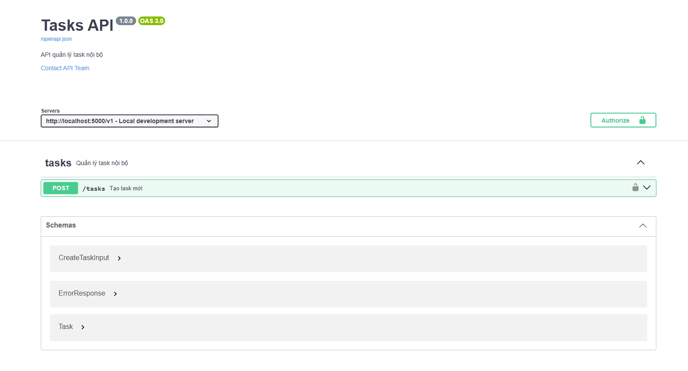
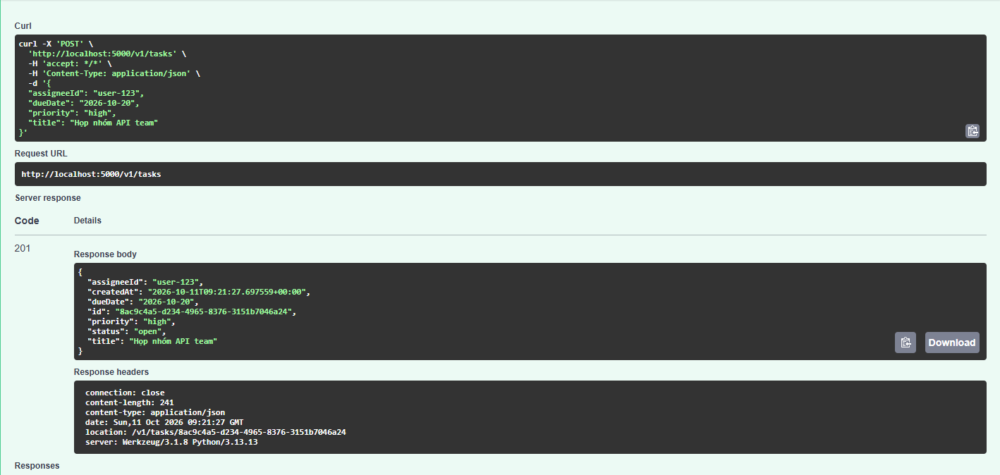
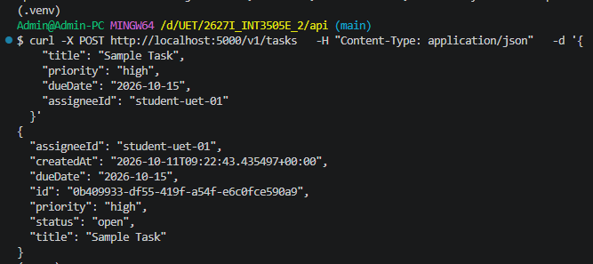

# Tasks API: OpenAPI + Flask + Swagger UI

## Files
- `openapi.yaml`: Đặc tả OpenAPI Specification cho endpoint `POST /v1/tasks`
- `app.py`: Flask app implement `POST /v1/tasks` + `GET /openapi.json` + `GET /docs`
- `README.md`: Read me

---

## Test
- Base URL: http://localhost:5000/v1
- OpenAPI JSON: http://localhost:5000/openapi.json
- Swagger UI: http://localhost:5000/docs

Test qua cURL:
```
curl -X POST http://localhost:5000/v1/tasks \
  -H "Content-Type: application/json" \
  -d '{
    "title": "Sample Task",
    "priority": "high",
    "dueDate": "2026-10-15",
    "assigneeId": "student-uet-01"
  }'
```

### Proofs:

#### Swagger UI:



#### "Try it out" hoạt động:



#### Test qua cURL:



## Hai quyết định thiết kế khó nhất

**1. Tách rời Schema Input (`createTaskInput`) và Schema Resource (`Task`).**
Một thực thể `Task` đầy đủ luôn chứa các thuộc tính do hệ thống tự sinh như `id`, `status`, `createdAt`. Nếu dùng chung một schema cho cả request body và response thì client có thể vô tình truyền `id` hoặc thay đổi `status` ngay khi vừa tạo.

**2. Chuẩn hoá phản hồi lỗi theo RFC 7807, phân biệt status code `400` và `422`.**
Một lỗi phổ biến khi thiết kế API là trả về `200 OK` cho tất cả tình huống kèm theo thông báo lỗi trong body, hoặc gộp toàn bộ lỗi vào mã `400 Bad Request` gây khó khăn cho client trong việc xử lý.
