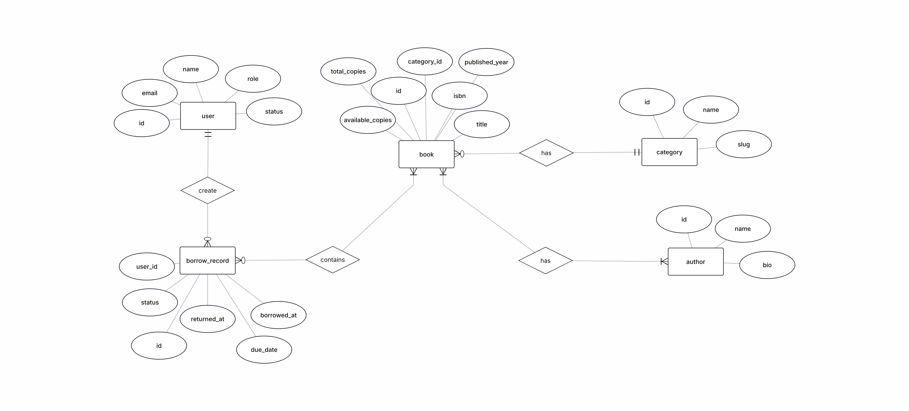

# Bài 1: Thiết kế API cho Hệ thống Quản lý Thư viện

---

### 1.1 Bảng Resource

| Resource | Thuộc tính (Attribute) | Kiểu dữ liệu | Ràng buộc | Mô tả |
| :--- | :--- | :--- | :--- | :--- |
| **Book** | `id` | string PK | Bắt buộc, duy nhất | Mã định danh dạng `book_{id}` |
| **Book** | `isbn` | string(13) | Bắt buộc, duy nhất | Mã chuẩn quốc tế (13 chữ số) |
| **Book** | `title` | string(255) | Bắt buộc | Tiêu đề của cuốn sách |
| **Book** | `published_year` | integer | Tùy chọn | Năm xuất bản |
| **Book** | `total_copies` | integer | Bắt buộc, >= 1 | Tổng số sách thư viện sở hữu |
| **Book** | `available_copies`| integer | Bắt buộc, >= 0 | Số sách hiện còn sẵn trên kệ |
| **Book** | `category_id` | integer FK | Bắt buộc | Tham chiếu sang bảng `Category` |
| **Category** | `id` | integer PK | Bắt buộc | Mã định danh thể loại |
| **Category** | `name` | string(100) | Bắt buộc | Tên thể loại |
| **Category** | `slug` | string(50) | Bắt buộc, duy nhất | Khoá dùng trong bộ lọc |
| **Author** | `id` | integer PK | Bắt buộc | Mã định danh tác giả |
| **Author** | `name` | string(100) | Bắt buộc | Họ và tên tác giả |
| **Author** | `bio` | text | Tùy chọn | Tiểu sử của tác giả |
| **BookAuthor** | `book_id` | integer PK/FK | Bắt buộc | Khóa ngoại tham chiếu sang `Book` |
| **BookAuthor** | `author_id` | integer PK/FK | Bắt buộc | Khóa ngoại tham chiếu sang `Author` |
| **BookAuthor** | `role` | string(20) | Bắt buộc | Vai trò |
| **User** | `id` | string PK | Bắt buộc, duy nhất | Mã định danh dạng `user_{id}` |
| **User** | `email` | string(255) | Bắt buộc, duy nhất | Email |
| **User** | `full_name` | string(100) | Bắt buộc | Họ tên người dùng |
| **User** | `role` | string(20) | Bắt buộc | Phân quyền |
| **User** | `status` | string(20) | Bắt buộc | Trạng thái |
| **User** | `created_at` | timestamp | Bắt buộc | Thời điểm tạo tài khoản |
| **BorrowRecord** | `id` | string PK | Bắt buộc, duy nhất | Mã phiếu mượn dạng `loan_{id}` |
| **BorrowRecord** | `user_id` | string FK | Bắt buộc | Khóa ngoại tham chiếu sang `User` |
| **BorrowRecord** | `borrowed_at` | timestamp | Bắt buộc | Thời điểm mượn |
| **BorrowRecord** | `due_date` | timestamp | Bắt buộc | Hạn chót phải trả sách |
| **BorrowRecord** | `returned_at` | timestamp | Tùy chọn | Thời điểm trả sách thực tế |
| **BorrowRecord** | `status` | string(20) | Bắt buộc | Trạng thái |
| **BorrowItem** | `id` | integer PK | Bắt buộc | Mã chi tiết mượn sách |
| **BorrowItem** | `borrow_record_id`| string FK | Bắt buộc | Khóa ngoại tham chiếu `BorrowRecord` |
| **BorrowItem** | `book_id` | integer FK | Bắt buộc | Khóa ngoại tham chiếu `Book` |

---

### 1.2 Quan hệ giữa các Resource

| Quan hệ | Kiểu | Vị trí khóa ngoại | Cardinality & Diễn giải |
| :--- | :---: | :--- | :--- |
| **Category — Book** | 1:N | `books.category_id` | Một thể loại chứa nhiều sách; một sách thuộc đúng một thể loại. |
| **Book — Author** | M:N | `book_authors (book_id, author_id)` | Một sách có nhiều tác giả; một tác giả tham gia viết nhiều sách. |
| **User — BorrowRecord** | 1:N | `borrow_records.user_id` | Một độc giả có thể có nhiều phiếu mượn; mỗi phiếu mượn thuộc sở hữu của đúng một người dùng. |
| **BorrowRecord — BorrowItem** | 1:N | `borrow_items.borrow_record_id` | Phiếu mượn chứa danh sách các mục sách được mượn. |
| **Book — BorrowItem** | 1:N | `borrow_items.book_id` | Một cuốn sách có thể xuất hiện trong nhiều chi tiết phiếu mượn khác nhau. |

---

## 2. URL List – 16 Endpoints

Tất cả các endpoint sử dụng tiền tố `/api/v1`, tuân thủ cú pháp danh từ số nhiều (kebab-case) và trả về dữ liệu định dạng JSON.

| # | Method | Path | Mô tả nghiệp vụ |
| :---: | :---: | :--- | :--- |
| **1** | `GET` | `/api/v1/books` | Danh sách sách: hỗ trợ lọc `?genre=`, sắp xếp đa khóa `?sort=`, phân trang `?strategy=offset\|cursor`. |
| **2** | `POST` | `/api/v1/books` | Tạo mới một đầu sách; kiểm tra dữ liệu bằng JSON Schema. |
| **3** | `GET` | `/api/v1/books/{id}` | Lấy thông tin chi tiết một cuốn sách theo mã định danh. |
| **4** | `PUT` | `/api/v1/books/{id}` | Cập nhật toàn bộ thông tin của một đầu sách. |
| **5** | `DELETE` | `/api/v1/books/{id}` | Xóa một đầu sách khỏi hệ thống. |
| **6** | `GET` | `/api/v1/books/{id}/authors` | Xem danh sách tác giả và vai trò tham gia của một cuốn sách (Sub-resource). |
| **7** | `POST` | `/api/v1/books/{id}/authors` | Gán thêm tác giả và vai trò vào cuốn sách (body: `author_id`, `role`). |
| **8** | `DELETE` | `/api/v1/books/{id}/authors/{author_id}` | Hủy liên kết tác giả khỏi một cuốn sách. |
| **9** | `GET` | `/api/v1/authors` | Lấy danh sách tất cả các tác giả. |
| **10** | `POST` | `/api/v1/authors` | Thêm mới thông tin tác giả vào hệ thống. |
| **11** | `GET` | `/api/v1/authors/{id}/books` | Danh sách các đầu sách được viết bởi tác giả `{id}`. |
| **12** | `GET` | `/api/v1/categories` | Lấy danh mục các thể loại sách. |
| **13** | `POST` | `/api/v1/categories` | Thêm mới một thể loại sách vào danh mục. |
| **14** | `GET` | `/api/v1/users/{id}/borrow-records` | Xem danh sách lịch sử các phiếu mượn sách của một người dùng cụ thể. |
| **15** | `POST` | `/api/v1/borrow-records` | Độc giả lập phiếu mượn sách mới (yêu cầu mảng danh sách `items` chứa `book_id`). |
| **16** | `PATCH` | `/api/v1/borrow-records/{id}/return` | Cập nhật hoàn tất thủ tục trả sách và thời gian trả cho phiếu mượn. |

---

## 3. ERD

