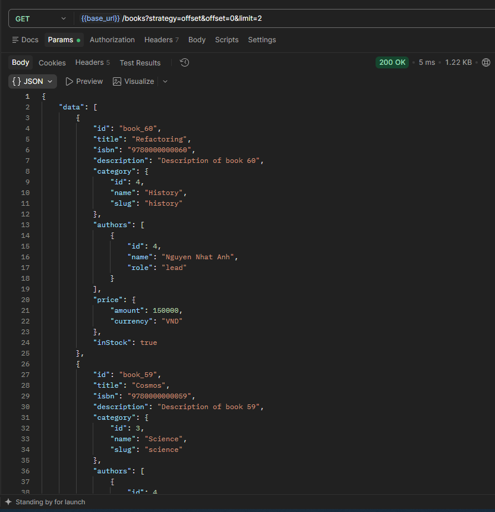
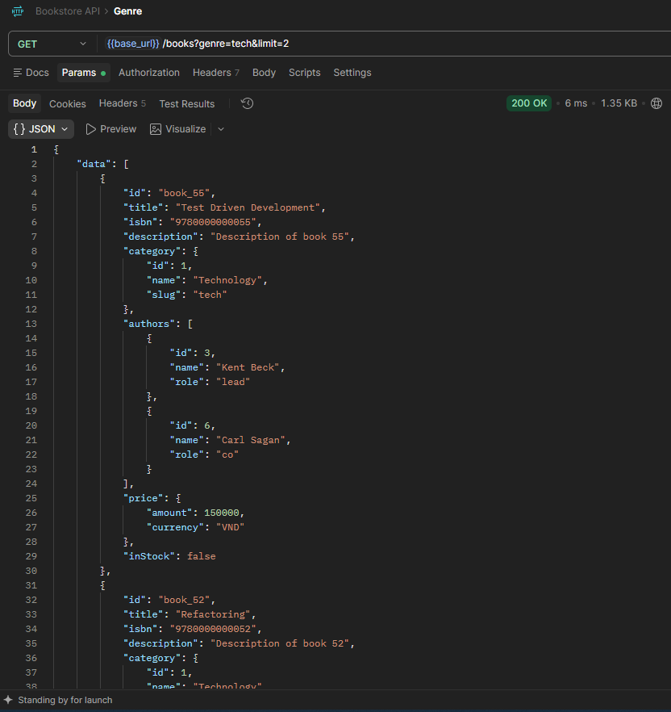
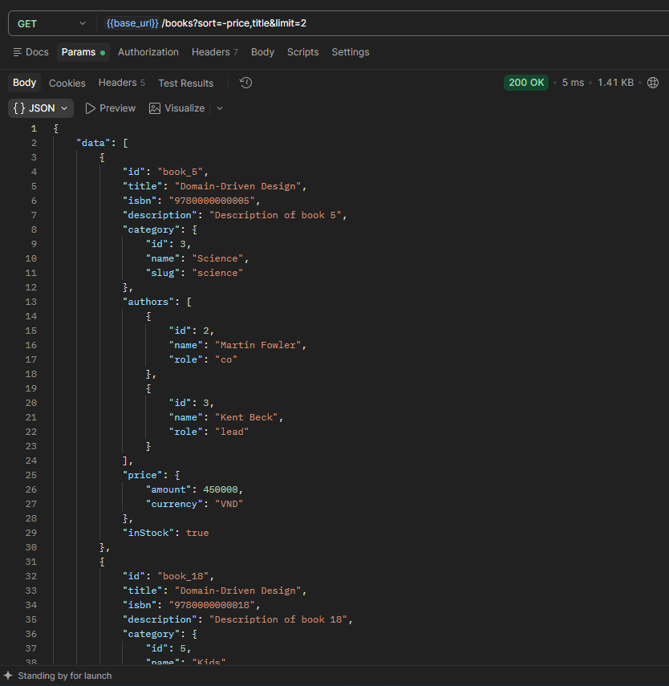
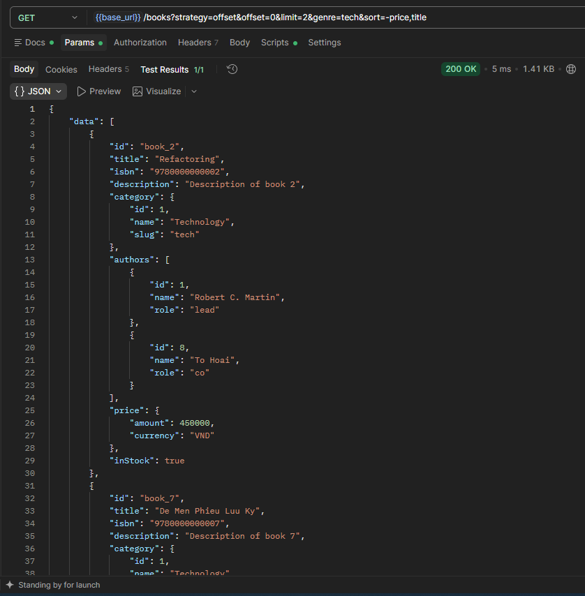
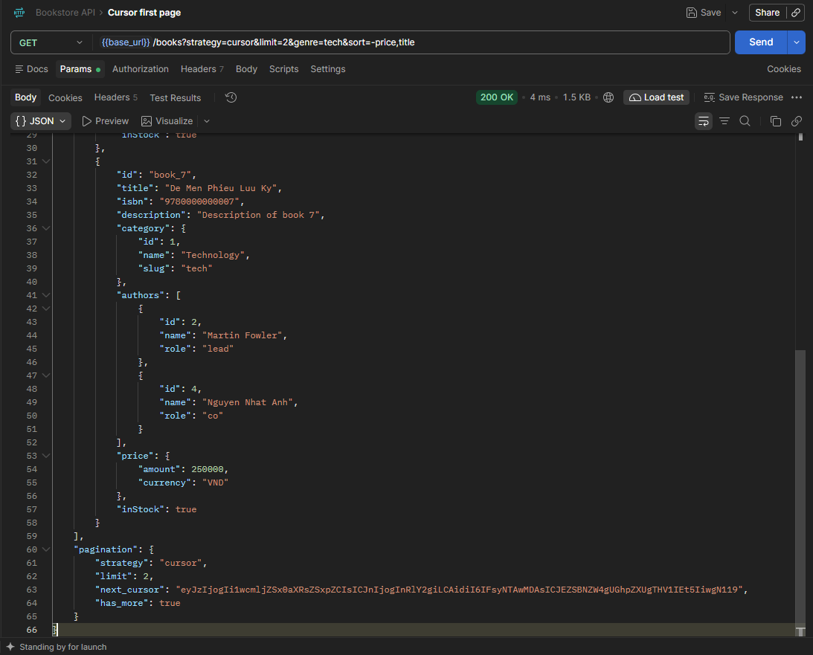
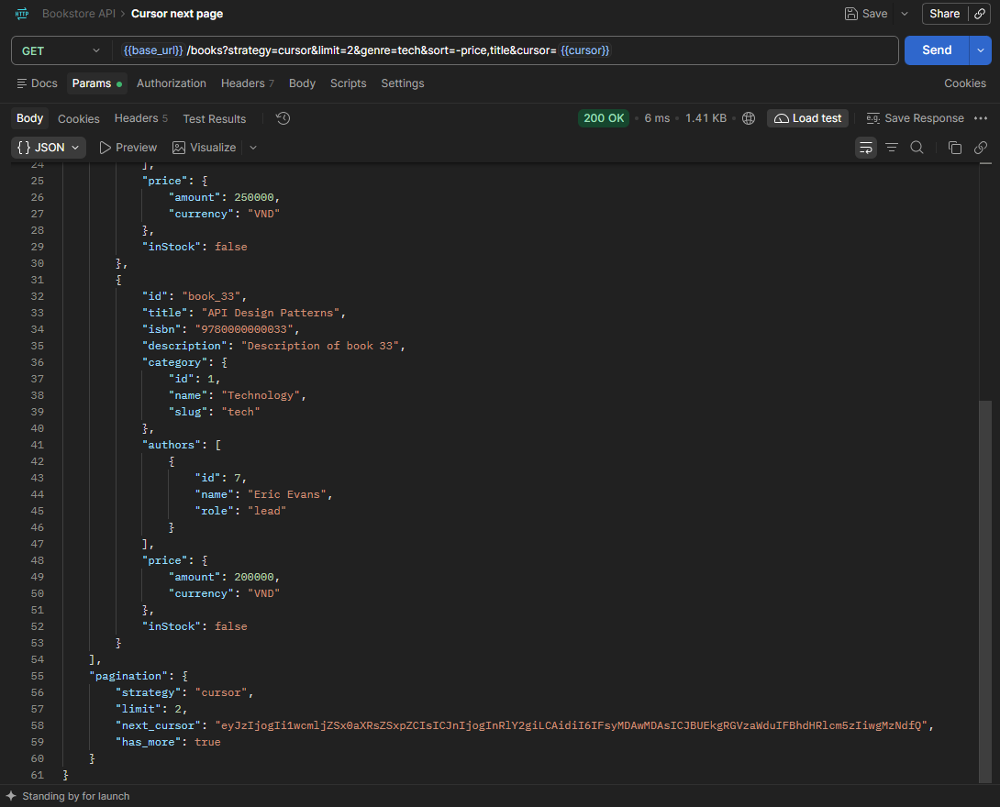

# Week 5: Bookstore API + Pagination

REST API cho hệ thống bán sách online, xây bằng **Flask + SQLAlchemy**, hoàn thiện endpoint `GET /api/v1/books` của Lab 1.

## Yêu cầu

- Python 3.10+
- Flask 3.x, Flask-SQLAlchemy 3.1+, SQLAlchemy 2.x
- pytest (để chạy test)

## Cài đặt và chạy

```bash
python -m venv venv
.\.venv\Scripts\Activate.ps1
pip install flask flask-sqlalchemy jsonschema pytest

flask --app app seed              # tạo 60 sách mẫu (bỏ qua nếu DB đã có dữ liệu)
cd week5/bookstore-api            
python app.py                     # http://localhost:5000
```

Các lệnh khác:

| Lệnh | Tác dụng |
|---|---|
| `flask --app app seed --count 200` | Tạo số sách mẫu tuỳ chọn |
| `flask --app app reset-db` | Xoá toàn bộ bảng rồi tạo lại |

## API

### `GET /api/v1/books`

| Tham số | Áp dụng | Mô tả |
|---|---|---|
| `strategy` | cả hai | `cursor` (mặc định) hoặc `offset` |
| `limit` | cả hai | Số item mỗi trang. Mặc định 20, tối đa 100 |
| `offset` | offset | Vị trí bắt đầu, mặc định 0 |
| `cursor` | cursor | Token lấy từ `pagination.next_cursor` của trang trước |
| `sort` | cả hai | Danh sách key cách nhau. Mặc định `-id` |
| `genre` | cả hai | Lọc theo `slug` của category |
| `in_stock` | cả hai | `true` để chỉ lấy sách còn hàng |
| `price_min`, `price_max` | cả hai | Khoảng giá (VND) |

#### Ví dụ

```bash
# Trang đầu, cursor, mặc định
curl "localhost:5000/api/v1/books?limit=5"

# Filter genre + sort nhiều key
curl "localhost:5000/api/v1/books?genre=tech&sort=-price,title&limit=10"

# Trang kế tiếp: dùng nguyên next_cursor, giữ nguyên sort và genre
curl "localhost:5000/api/v1/books?genre=tech&sort=-price,title&limit=10&cursor=<next_cursor>"

# Offset: nhảy tới trang 3
curl "localhost:5000/api/v1/books?strategy=offset&offset=20&limit=10"
```

#### Response — cursor

```json
{
  "data": [
    {
      "id": "book_2",
      "title": "Refactoring",
      "isbn": "9780000000002",
      "description": "Description of book 2",
      "category": {"id": 1, "name": "Technology", "slug": "tech"},
      "authors": [{"id": 1, "name": "Robert C. Martin", "role": "lead"}],
      "price": {"amount": 450000, "currency": "VND"},
      "inStock": true,
      "createdAt": "2026-10-20T01:33:03Z"
    }
  ],
  "pagination": {
    "strategy": "cursor",
    "limit": 10,
    "next_cursor": "eyJzIjoiLXByaWNlLHRpdGxlLGlkIiwi...",
    "has_more": true
  }
}
```

`next_cursor` là `null` khi hết dữ liệu.

#### Response — offset

```json
{
  "data": [ ... ],
  "pagination": {
    "strategy": "offset",
    "offset": 20,
    "limit": 10,
    "total": 60,
    "has_more": true
  }
}
```

#### Lỗi

Mọi lỗi đều trả JSON dạng `{"error": "<code>", "message": "..."}`.

| HTTP | `error` | Khi nào |
|---|---|---|
| 400 | `bad_sort` | Sort key không có trong whitelist, bị lặp, hoặc quá 3 key |
| 400 | `bad_strategy` | `strategy` không phải `offset` hoặc `cursor` |
| 400 | `bad_cursor` | Cursor không giải mã được hoặc sai cấu trúc |
| 400 | `cursor_mismatch` | Cursor được tạo với `sort` hoặc `genre` khác với request hiện tại |
| 404 / 405 | `not_found` / `method_not_allowed` | Sai URL hoặc method |

## Postman

Import `postman_collection.json`

## Proofs

### `?strategy=offset`



### `?genre=tech`



### `?sort=-price,title`



### Offset + genre + sort multi-key



### Cursor first page



### Cursor next page

